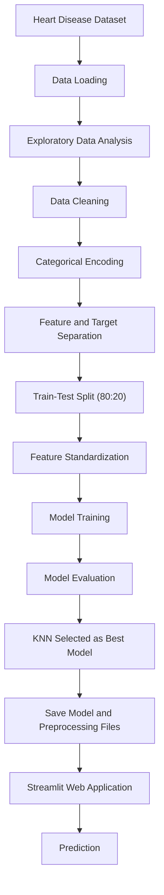

# Heart Disease Risk Prediction System

A Machine Learning-based application that predicts the risk of heart disease using patient health information. The project explores multiple classification algorithms, compares their performance, and deploys the best-performing model through a Streamlit web application.

## Project Overview

Heart disease is one of the major health concerns worldwide. Early risk assessment using patient health data can support awareness and encourage timely medical consultation.

This project implements a machine learning classification system using the Heart Disease dataset. Five classification algorithms were trained and evaluated. Based on the experimental results, the K-Nearest Neighbors (KNN) model achieved the highest accuracy and F1-score among the evaluated models.

The selected KNN model, along with its preprocessing components, was saved and integrated into a Streamlit application for interactive prediction.

## Key Features

- Exploratory Data Analysis (EDA) and data visualization.
- Data cleaning and preprocessing.
- Handling zero values in selected numerical features.
- One-Hot Encoding for categorical variables.
- Feature standardization using StandardScaler.
- Training and comparison of five machine learning algorithms.
- Model evaluation using Accuracy and F1-score.
- Selection of the best-performing KNN model.
- Model persistence using Joblib.
- Interactive web application built with Streamlit.
- Deployment through Streamlit Community Cloud.

## Dataset Information

The project uses a heart disease dataset containing **918 records and 12 columns**.

### Dataset Features

| Feature | Description |
|---|---|
| Age | Age of the patient |
| Sex | Sex of the patient |
| ChestPainType | Type of chest pain |
| RestingBP | Resting blood pressure |
| Cholesterol | Serum cholesterol level |
| FastingBS | Fasting blood sugar |
| RestingECG | Resting electrocardiogram results |
| MaxHR | Maximum heart rate achieved |
| ExerciseAngina | Exercise-induced angina |
| Oldpeak | ST depression induced by exercise |
| ST_Slope | Slope of the peak exercise ST segment |
| HeartDisease | Target variable |

**Target Variable:** `HeartDisease`

- `0` – No heart disease (according to the dataset label).
- `1` – Heart disease (according to the dataset label).

## Project Workflow

The overall workflow followed in this project:



## 1. Exploratory Data Analysis (EDA)

Exploratory Data Analysis was performed to understand the dataset, examine feature distributions, identify patterns, and explore relationships between variables.

### Initial Dataset Inspection

The following checks were performed:

- Dataset shape and structure.
- Data types of individual columns.
- Missing value inspection.
- Duplicate record inspection.
- Statistical summary of numerical features.

The initial inspection found no missing values or duplicate records.

### Data Visualization

Different visualization techniques were used to understand the dataset.

| Visualization | Purpose |
|---|---|
| Count Plot | Analyze categorical feature distributions |
| Histogram | Examine numerical feature distributions |
| Box Plot | Investigate cholesterol distribution against heart disease labels |
| Violin Plot | Compare age distributions across target classes |
| Correlation Heatmap | Examine relationships between numerical features |

The following features were explored using visualizations:

- Sex
- ChestPainType
- FastingBS
- Age
- RestingBP
- Cholesterol
- MaxHR
- HeartDisease

The `sheryanalysis` library was also used for automated basic data analysis.

## 2. Data Cleaning and Preprocessing

Data preprocessing was performed before training the machine learning models.

### Handling Zero Values

Zero values in `Cholesterol` and `RestingBP` were treated as invalid measurements for this dataset.

These values were replaced with the mean of the non-zero observations in their respective columns.

### One-Hot Encoding

Categorical variables were converted into numerical representations using Pandas:


The categorical features included:

- Sex
- ChestPainType
- RestingECG
- ExerciseAngina
- ST_Slope


### Feature Standardization

This is particularly important for distance-based and margin-based algorithms such as KNN and SVM.

## 3. Machine Learning Models

Five supervised machine learning classification algorithms were trained and evaluated.

| Algorithm | Description |
|---|---|
| Logistic Regression | Linear classification algorithm |
| K-Nearest Neighbors (KNN) | Distance-based classification algorithm |
| Gaussian Naive Bayes | Probabilistic classification algorithm |
| Decision Tree | Tree-based classification algorithm |
| Support Vector Machine (SVM) | Margin-based classification using RBF kernel |

### Model Evaluation

The models were evaluated using two performance metrics:

**Accuracy**

Measures the proportion of correctly predicted observations.

**F1-Score**

Represents the harmonic mean of Precision and Recall, providing a balance between the two metrics.

## 4. Model Performance Comparison

The following table presents the experimental results obtained during model evaluation.

| Model | Accuracy | F1-Score |
|---|---:|---:|
| Logistic Regression | 87.50% | 88.78% |
| K-Nearest Neighbors (KNN) | **88.59%** | **89.86%** |
| Gaussian Naive Bayes | 86.96% | 87.88% |
| Decision Tree | 74.46% | 75.13% |
| Support Vector Machine (SVM) | 86.41% | 88.04% |

### Accuracy Comparison

```text
KNN                 88.59%  ██████████████████
Logistic Regression 87.50%  █████████████████
Naive Bayes         86.96%  █████████████████
SVM                 86.41%  █████████████████
Decision Tree       74.46%  ███████████████
```

### Best Performing Model

**K-Nearest Neighbors (KNN)** achieved the best overall results among the five evaluated algorithms.

- Accuracy: 88.59%
- F1-Score: 89.86%

Based on these evaluation results, KNN was selected as the final model for the prediction application.

The selection was based on the measured performance rather than assuming that one algorithm is universally better than the others.


### Application Workflow

1. User enters the required health information.
2. The application prepares the input features.
3. Categorical input values are converted into the expected feature representation.
4. Missing expected feature columns are filled with zero.
5. Features are reordered according to the saved training columns.
6. The saved StandardScaler transforms the input.
7. The KNN model generates a prediction.
8. The application displays the prediction result.

### Input Features

The application accepts the following information:

- Age
- Sex
- Chest Pain Type
- Resting Blood Pressure
- Cholesterol
- Fasting Blood Sugar
- Resting ECG
- Maximum Heart Rate
- Exercise-Induced Angina
- Oldpeak
- ST Slope

### Deployment

The application is deployed using Streamlit Community Cloud.

The deployment uses the GitHub repository as its source and installs the required Python dependencies through `requirements.txt`.

**Live Application:** [Open Heart Disease Risk Prediction System](https://heart-risk-check.streamlit.app/)

**GitHub Repository:** [View Source Code](https://github.com/mehedihasanovi222/Heart-Disease-Risk-Prediction-System)

## 7. Project Structure

```text
Heart-Disease-Risk-Prediction-System/
│
├── .streamlit/
│   └── config.toml
│
├── app.py
│
├── knn_heart_model.pkl
├── heart_scaler.pkl
├── heart_columns.pkl
│
├── requirements.txt
│
└── README.md
```


.

## 9. Technologies and Libraries

The following tools and libraries were used throughout the project.

| Technology | Purpose |
|---|---|
| Python | Main programming language |
| Pandas | Data manipulation and preprocessing |
| NumPy | Numerical operations |
| Matplotlib | Data visualization |
| Seaborn | Statistical visualization |
| Scikit-learn | Machine learning algorithms and preprocessing |
| Joblib | Saving and loading trained models |
| Sheryanalysis | Automated basic data analysis |
| Jupyter Notebook / Google Colab | Model development and experimentation |
| Streamlit | Web application development |
| Git and GitHub | Version control and source code hosting |
| Streamlit Community Cloud | Application deployment |

## 10. Future Scope

The project can be extended in several ways:

- Evaluate additional machine learning algorithms.
- Perform hyperparameter tuning for improved model performance.
- Apply cross-validation for more reliable evaluation.
- Evaluate Precision, Recall, ROC-AUC, and confusion matrices.
- Investigate feature importance and model interpretability.
- Improve the prediction interface and user experience.
- Evaluate model generalization using independent datasets.
- Explore explainable AI techniques to make predictions easier to interpret.

## 11. Limitations and Disclaimer

This project is developed for educational and machine learning experimentation purposes.

The model's predictions are based on patterns learned from the available dataset. Its performance on the test set does not guarantee equivalent performance in real-world clinical settings.

**This application is not a medical diagnostic tool and should not replace professional medical advice, diagnosis, or treatment.** Users should consult qualified healthcare professionals for medical concerns.

## Author

**Mehedi Hasan Ovi**

Computer Science and Engineering (CSE)  
Southeast University, Bangladesh

**GitHub:** [@mehedihasanovi222](https://github.com/mehedihasanovi222)

---

*Developed as a Machine Learning project focused on heart disease risk prediction and model evaluation.*
